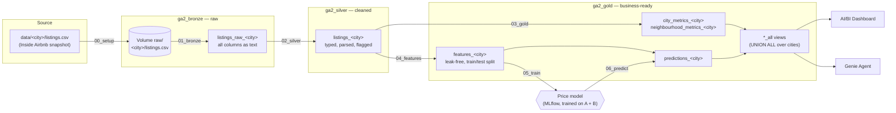

# Solution architecture

A medallion lakehouse on Databricks Free Edition (serverless, Unity Catalog catalog `workspace`).
One Databricks Job, parameterised by `city`, builds every layer for one city; adding a city means adding an entry to
[`config/cities.json`](../config/cities.json) and running the job again — no code is copied.

## Layers

| Layer | Purpose | Tables (`<city>` = `geneva`, `zurich`, `vaud`) |
|---|---|---|
| **Bronze** `ga2_bronze` | Keep the source exactly as published, so every later number can be traced back to it. No cleaning. | Volume `raw/<city_key>/listings.csv`; `listings_raw_<city>`: all source columns as strings + `city`, `snapshot_date`, `ingested_at` |
| **Silver** `ga2_silver` | One clean, typed row per listing. Applies the cleaning rules from the [exploratory analysis](../notebooks/eda/01_exploratory_analysis_A_B.ipynb). | `listings_<city>`: numeric `price` (CHF), `bathrooms` from text, booleans/dates typed, flags `has_price` and `outlier_class` |
| **Gold** `ga2_gold` | Answer questions: metrics for the dashboard and Genie, model inputs and outputs. | `city_metrics_<city>`, `neighbourhood_metrics_<city>`; `features_<city>` (leak-free columns, priced non-implausible listings, `split` = train/test); `predictions_<city>` (actual, predicted, baseline, error) |
| | Cross-city access for the dashboard and Genie, without duplicating data. | Views `city_metrics_all`, `neighbourhood_metrics_all`, `predictions_all`: `UNION ALL` over the cities in the config, regenerated by the job |

**Why one table per city.** Each city's tables are written independently, so a run for a new city cannot overwrite or
corrupt the tables of A and B, a failed run for one city leaves the others intact, and a city can be dropped by dropping
its tables. The `*_all` views give the dashboard and Genie a single place to compare cities.

## Pipeline: one Databricks Job

Defined in [`resources/etl_job.yml`](../resources/etl_job.yml); every task is a notebook from `notebooks/` run on
serverless compute.

| Task | Notebook | Runs | Reads → writes |
|---|---|---|---|
| setup | `00_setup` | once | repo `data/` → volume |
| bronze | `pipeline/01_bronze_ingest` | per city | volume → `listings_raw_<city>` |
| silver | `pipeline/02_silver_listings` | per city | bronze → `listings_<city>` |
| gold | `pipeline/03_gold_metrics` | per city | silver → metrics tables, refresh `*_all` views |
| features | `model/04_features` | per city | silver → `features_<city>` |
| train | `model/05_train_evaluate` | once, on `train` cities | `features_geneva` + `features_zurich` → model in MLflow, test MAE vs baseline |
| predict | `model/06_predict` | per city | features + model → `predictions_<city>` |

The per-city tasks take the job parameter `city` (a key from `cities.json`, e.g. `A_Geneva`); the job runs them for
each city with a for-each task. Table names are derived from the config, never typed in a notebook.

**Training is separate from the per-city run.** The model is trained only on the cities with role `train` (A and B).
For city C the job runs bronze → silver → gold → features → predict with the frozen week-1 model, which is exactly the
"unchanged first run" required for the city C report.

## Adding a city

1. Add the snapshot to `data/<key>/listings.csv` and an entry to `config/cities.json`.
2. Run the job with `city=<key>`.
3. The new city's tables appear and the `*_all` views include it on the next gold refresh. Nothing else changes.

Anything that breaks in step 2 is, by definition, a pipeline fix for the city C report.
