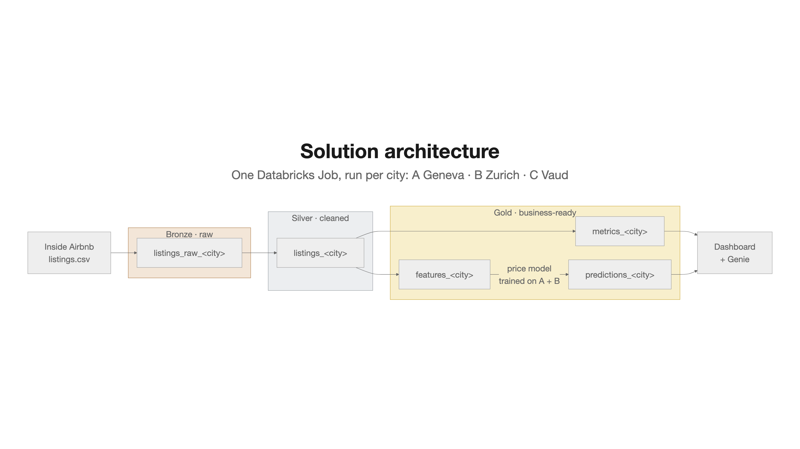
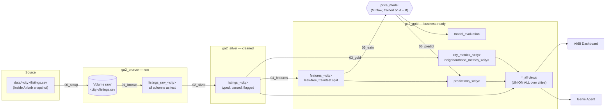

# Solution architecture

A medallion lakehouse on Databricks Free Edition (serverless, Unity Catalog catalog `workspace`).
Two Databricks Jobs: **`ga2_etl`** loads, cleans and transforms one city (the city is its parameter), and
**`ga2_model`** trains the price model on A + B and writes predictions. Adding a city means adding an entry to
[`config/cities.json`](../config/cities.json) and running the jobs for it — no code is copied.

Slide version: [`architecture.png`](architecture.png), from [`architecture_slide.mmd`](architecture_slide.mmd) (render at mermaid.live to edit). Detailed flow below.

## Layers

| Layer | Purpose | Tables (`<city>` = `geneva`, `zurich`, `vaud`) |
|---|---|---|
| **Bronze** `ga2_bronze` | Keep the source exactly as published, so every later number can be traced back to it. No cleaning. | Volume `raw/<city_key>/listings.csv`; `listings_raw_<city>`: all source columns as strings + `city`, `snapshot_date`, `ingested_at` |
| **Silver** `ga2_silver` | One clean, typed row per listing. Applies the cleaning rules from the [exploratory analysis](../notebooks/eda/01_exploratory_analysis_A_B.ipynb). | `listings_<city>`: numeric `price` (CHF), `bathrooms` from text, booleans/dates typed, flags `has_price` and `outlier_class` |
| **Gold** `ga2_gold` | Answer questions: metrics for the dashboard and Genie, model inputs and outputs. | `city_metrics_<city>` (per room type + `All` row), `neighbourhood_metrics_<city>`; `features_<city>` (leak-free columns, `label_ok`, `split` = train/test); `predictions_<city>` (actual, predicted, baseline, error); `model_evaluation` (test MAE vs baseline) |
| | Cross-city access for the dashboard and Genie, without duplicating data. | Views `city_metrics_all`, `neighbourhood_metrics_all`, `listings_all` (curated listing rows, no leak columns), `predictions_all`: `UNION ALL` over every city whose tables exist |

**Why one table per city.** Each city's tables are written independently, so a run for a new city cannot overwrite or
corrupt the tables of A and B, a failed run for one city leaves the others intact, and a city can be dropped by dropping
its tables. The `*_all` views give the dashboard and Genie a single place to compare cities.

## Jobs

Defined as a Databricks Asset Bundle ([`databricks.yml`](../databricks.yml), [`resources/`](../resources/)); every
task is a notebook run on serverless compute. Table names are derived from the config, never typed in a notebook.

### `ga2_etl` — the data pipeline (deliverable 3.3)

One parameter, `city` (a key from `cities.json`, e.g. `A_Geneva`). Tasks run in sequence:

| Task | Notebook | Reads → writes |
|---|---|---|
| setup | `00_setup` | repo `data/<city>/` → volume (creates schemas on first run) |
| bronze | `pipeline/01_bronze_ingest` | volume → `listings_raw_<city>` |
| silver | `pipeline/02_silver_listings` | bronze → `listings_<city>` |
| gold | `pipeline/03_gold_metrics` | silver → metrics tables; refresh `city_metrics_all`, `neighbourhood_metrics_all`, `listings_all` |
| features | `pipeline/04_features` | silver → `features_<city>` |

It is run once per city — for A and B in week 1, for C in week 2 — with the same code.

### `ga2_model` — the price model (deliverable 3.4)

| Task | Notebook | Runs | Reads → writes |
|---|---|---|---|
| train | `model/05_train_evaluate` | once | `features_<city>` of the `train` cities (A, B) → `price_model` (alias `champion`), `model_evaluation` |
| predict | `model/06_predict` | for each city in `city_keys` | `features_<city>` + `champion` model → `predictions_<city>`; refresh `predictions_all` |

The model is chosen by 5-fold cross-validation on the train rows: a linear regression or a shallow gradient boosting
with monotonic constraints (more guests, bedrooms, bathrooms or amenities never lower the price; distance from the
centre, a shared bathroom or a long-stay minimum never raise it). The test rows are only used for the final MAE.

`ga2_predict` (parameter `city`) runs `06_predict` alone. It prices a new city with the current `champion`.

`model/07_transfer_rehearsal` is run once by hand after `ga2_model`: it trains on Geneva and prices Zurich (and the
reverse) to estimate the city C error before city C is loaded, and stores that estimate in `city_c_expectation`.

**Training and ETL are separate.** The ETL job never touches the model, and the model job only reads gold features.
For city C, `ga2_etl` runs with `city=C_Vaud` and then only `ga2_predict` runs for Vaud: the model is not retrained, which
is exactly the "unchanged first run" required for the city C report. Failures in `ga2_etl` are pipeline fixes; failures
or poor accuracy in `ga2_model` are model changes — the two categories of the report.

## Adding a city

1. Add the snapshot to `data/<key>/listings.csv` and an entry to `config/cities.json`.
2. Run `ga2_etl` with `city=<key>`, then `ga2_predict` with `city=<key>`.
3. The new city's tables appear and the `*_all` views include it. Nothing else changes.

Anything that breaks in step 2 is, by definition, a pipeline fix or a model change for the city C report.
